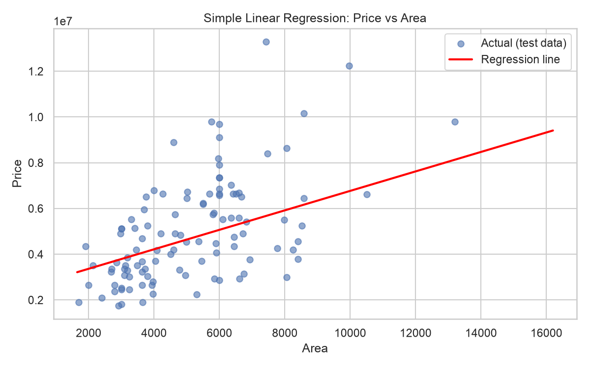
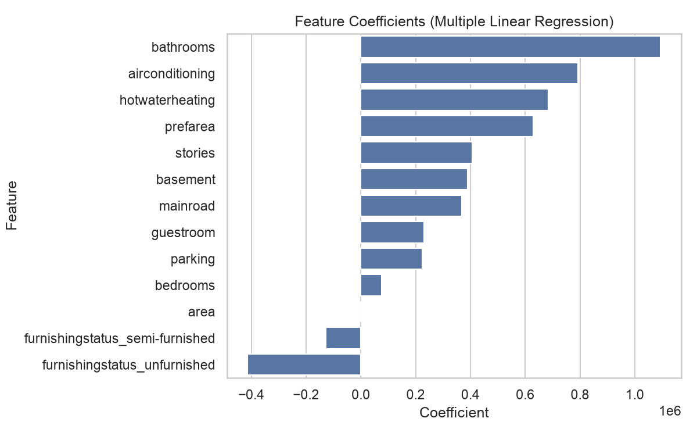
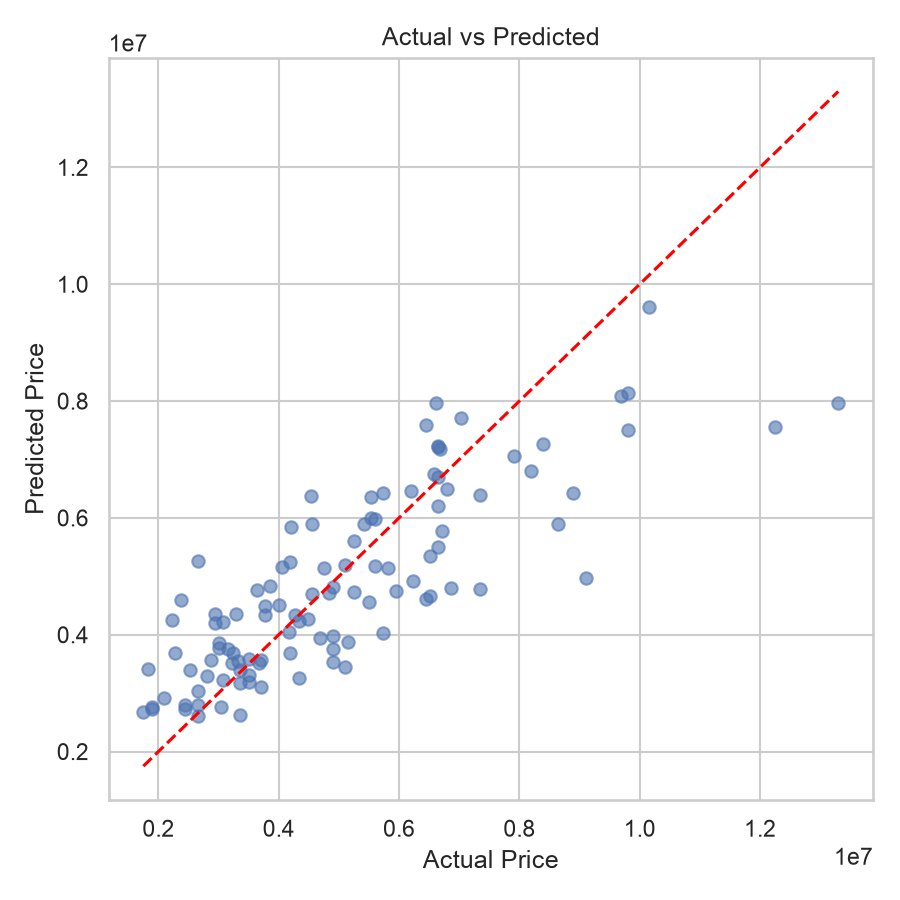
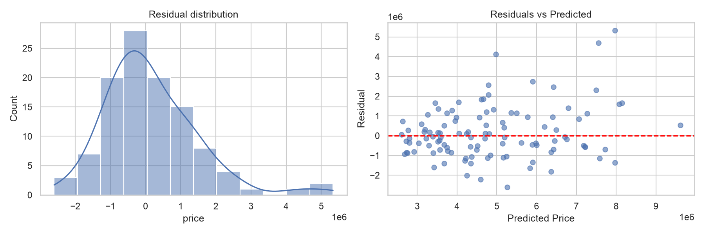

# Task 3: Linear Regression (House Price Prediction)

**Elevate Labs AIML Internship, Task 3**

## Objective
Implement and understand **simple** and **multiple** linear regression: prepare data, split it into train and test sets, fit a model with scikit-learn, evaluate it with MAE, MSE and R², plot the regression line, and interpret the coefficients.

## Tools Used
Python 3.11, Pandas, NumPy, Matplotlib, Seaborn, scikit-learn, Jupyter Notebook (in VS Code)

## Dataset
House Price Prediction dataset (`data/Housing.csv`): 545 houses and 13 columns. The target is `price`. The features include `area`, `bedrooms`, `bathrooms`, `stories`, `parking`, yes/no amenities (`mainroad`, `guestroom`, `basement`, `hotwaterheating`, `airconditioning`, `prefarea`) and `furnishingstatus`.

## Project Structure
```
Elevate-labs-aiml-task-3-linear-regression/
├── data/
│   └── Housing.csv
├── images/
│   ├── simple_regression_line.png
│   ├── coefficients.png
│   ├── actual_vs_predicted.png
│   └── residuals.png
├── task3_linear_regression.ipynb       # main notebook
├── .gitignore
└── README.md
```

## How to Run
```bash
git clone <this-repo-url>
cd Elevate-labs-aiml-task-3-linear-regression
python3 -m venv venv
source venv/bin/activate
pip install pandas numpy matplotlib seaborn scikit-learn ipykernel
```
Open `task3_linear_regression.ipynb` in VS Code (or Jupyter), select the `venv` kernel, and run all cells from top to bottom.

---

## Steps Performed (with line-by-line explanation)

### Step 1: Import libraries and explore the data

```python
import pandas as pd
import numpy as np
import matplotlib.pyplot as plt
import seaborn as sns
from sklearn.model_selection import train_test_split
from sklearn.linear_model import LinearRegression
from sklearn.metrics import mean_absolute_error, mean_squared_error, r2_score

sns.set_theme(style="whitegrid")

df = pd.read_csv("data/Housing.csv")
print("Shape:", df.shape)
df.head()
```
- `import pandas as pd`: loads Pandas for working with tables (DataFrames).
- `import numpy as np`: loads NumPy for numerical work (square roots, number ranges).
- `import matplotlib.pyplot as plt`: loads Matplotlib for plotting.
- `import seaborn as sns`: loads Seaborn for nicer statistical plots.
- `from sklearn.model_selection import train_test_split`: imports the function that splits data into a training set and a test set.
- `from sklearn.linear_model import LinearRegression`: imports the linear regression model.
- `from sklearn.metrics import ...`: imports the three evaluation metrics: MAE (mean absolute error), MSE (mean squared error) and R² (coefficient of determination).
- `sns.set_theme(style="whitegrid")`: sets a clean plot style for all charts.
- `df = pd.read_csv("data/Housing.csv")`: reads the CSV into a DataFrame called `df`.
- `print("Shape:", df.shape)`: prints (rows, columns) so we know the size of the data.
- `df.head()`: shows the first 5 rows to see what the columns contain.

```python
df.info()
print(df.isnull().sum())
df.describe()
```
- `df.info()`: lists each column with its non-null count and data type. Text columns (`object`) will need encoding.
- `df.isnull().sum()`: counts missing values per column.
- `df.describe()`: shows mean, std, min, quartiles and max for the numeric columns, to understand scale and spread.

---

### Step 2: Preprocess the data

Linear regression only works with numbers, so text columns must be converted.

```python
yes_no_cols = ["mainroad", "guestroom", "basement", "hotwaterheating",
               "airconditioning", "prefarea"]
for col in yes_no_cols:
    df[col] = df[col].map({"yes": 1, "no": 0})

df = pd.get_dummies(df, columns=["furnishingstatus"], drop_first=True, dtype=int)
df.head()
```
- `yes_no_cols = [...]`: the list of columns that only contain "yes" or "no".
- `for col in yes_no_cols:`: repeats the next line for each of those columns.
- `df[col].map({"yes": 1, "no": 0})`: replaces "yes" with 1 and "no" with 0 using the dictionary.
- `df[col] = ...`: saves the converted column back into the DataFrame.
- `pd.get_dummies(df, columns=["furnishingstatus"], ...)`: one-hot encodes `furnishingstatus`, which has 3 unordered categories, creating one 0/1 column per category.
- `drop_first=True`: drops the first dummy column. It's redundant (if the other two are 0, it must be the dropped one), and keeping it would create perfect multicollinearity (the "dummy variable trap").
- `dtype=int`: stores the new columns as 0/1 integers instead of True/False.
- `df.head()`: confirms all columns are now numeric.

```python
print(df.isnull().sum().sum(), "missing values")
print(df.dtypes)
```
- `df.isnull().sum().sum()`: the first `sum()` counts missing values per column and the second adds them up into one total. It should be 0.
- `df.dtypes`: lists each column's type, which should all be numeric now.

---

### Step 3: Simple linear regression (one feature)

Simple regression predicts `price` from **one** feature, `area`: `price = intercept + coefficient × area`.

```python
X_simple = df[["area"]]
y = df["price"]

X_train_s, X_test_s, y_train_s, y_test_s = train_test_split(
    X_simple, y, test_size=0.2, random_state=42)

simple_model = LinearRegression()
simple_model.fit(X_train_s, y_train_s)

y_pred_s = simple_model.predict(X_test_s)

print("Intercept:", round(simple_model.intercept_, 2))
print("Coefficient (area):", round(simple_model.coef_[0], 2))
```
- `X_simple = df[["area"]]`: the input feature. The double brackets keep it as a 2D table, which scikit-learn requires.
- `y = df["price"]`: the target we want to predict (a 1D column).
- `train_test_split(X_simple, y, test_size=0.2, random_state=42)`: randomly splits the data into 80% for training and 20% for testing. `test_size=0.2` sets that ratio, and `random_state=42` fixes the shuffle so results are reproducible.
- `X_train_s, X_test_s, y_train_s, y_test_s = ...`: the four resulting pieces: training inputs, test inputs, training targets and test targets.
- `simple_model = LinearRegression()`: creates an empty linear regression model.
- `simple_model.fit(X_train_s, y_train_s)`: **trains** the model. It finds the line that minimizes the squared error on the training data.
- `simple_model.predict(X_test_s)`: uses the trained model to predict prices for the unseen test houses.
- `simple_model.intercept_`: the predicted price when area is 0 (where the line crosses the y-axis).
- `simple_model.coef_[0]`: the slope, meaning how much the price changes for each 1-unit increase in area.
- `round(..., 2)`: rounds to 2 decimals for readability.

---

### Step 4: Evaluate the model with MAE, MSE and R²

```python
def evaluate(y_true, y_pred, label):
    mae = mean_absolute_error(y_true, y_pred)
    mse = mean_squared_error(y_true, y_pred)
    rmse = np.sqrt(mse)
    r2 = r2_score(y_true, y_pred)
    print(f"{label}")
    print(f"  MAE : {mae:,.2f}")
    print(f"  MSE : {mse:,.2f}")
    print(f"  RMSE: {rmse:,.2f}")
    print(f"  R²  : {r2:.4f}\n")

evaluate(y_test_s, y_pred_s, "Simple Linear Regression (area only)")
```
- `def evaluate(y_true, y_pred, label):`: defines a reusable function so the same report can be printed for both models.
- `mean_absolute_error(y_true, y_pred)`: **MAE**, the average absolute difference between actual and predicted prices. It's in the same units as price, so it's easy to interpret.
- `mean_squared_error(y_true, y_pred)`: **MSE**, the average of the squared differences. Squaring punishes large errors more heavily.
- `np.sqrt(mse)`: **RMSE**, the square root of MSE, which brings the error back to the original units of price.
- `r2_score(y_true, y_pred)`: **R²**, the share of the variation in price that the model explains (1 is perfect, 0 is no better than predicting the average).
- `print(f"  MAE : {mae:,.2f}")`: the `:,.2f` format adds thousands separators and shows 2 decimals.
- `evaluate(y_test_s, y_pred_s, "...")`: runs the report on the test set, so the numbers reflect performance on **unseen** data.

---

### Step 5: Plot the regression line

```python
plt.figure(figsize=(8, 5))
plt.scatter(X_test_s, y_test_s, alpha=0.6, label="Actual (test data)")
line_x = np.linspace(X_simple["area"].min(), X_simple["area"].max(), 100).reshape(-1, 1)
line_y = simple_model.predict(pd.DataFrame(line_x, columns=["area"]))
plt.plot(line_x, line_y, color="red", linewidth=2, label="Regression line")
plt.xlabel("Area")
plt.ylabel("Price")
plt.title("Simple Linear Regression: Price vs Area")
plt.legend()
plt.tight_layout()
plt.savefig("images/simple_regression_line.png", dpi=150)
plt.show()
```
- `plt.figure(figsize=(8, 5))`: creates a blank figure of 8×5 inches.
- `plt.scatter(X_test_s, y_test_s, alpha=0.6, ...)`: plots the actual test houses as dots, with `alpha=0.6` making them semi-transparent so overlaps are visible.
- `np.linspace(min, max, 100)`: creates 100 evenly spaced area values from the smallest to the largest. These are used to draw a smooth line.
- `.reshape(-1, 1)`: turns them into a column (2D), the shape the model expects.
- `simple_model.predict(pd.DataFrame(line_x, columns=["area"]))`: predicts the price for each of those 100 areas. Wrapping them in a DataFrame with the `area` column name matches what the model was trained on.
- `plt.plot(line_x, line_y, color="red", ...)`: draws the regression line in red.
- `plt.xlabel`, `plt.ylabel`, `plt.title`, `plt.legend()`: add axis labels, a title and a legend.
- `plt.tight_layout()`, `plt.savefig(...)`, `plt.show()`: tidy the spacing, save the image for this README, and display it.



---

### Step 6: Multiple linear regression (all features)

Multiple regression predicts `price` from **several** features at once: `price = intercept + b1·area + b2·bedrooms + b3·bathrooms + ...`

```python
X = df.drop(columns=["price"])
y = df["price"]

X_train, X_test, y_train, y_test = train_test_split(
    X, y, test_size=0.2, random_state=42)

model = LinearRegression()
model.fit(X_train, y_train)

y_pred = model.predict(X_test)

evaluate(y_test, y_pred, "Multiple Linear Regression (all features)")
```
- `df.drop(columns=["price"])`: uses every column except the target as input features (`X`).
- `y = df["price"]`: the target.
- `train_test_split(...)`: the same 80/20 split and the same `random_state=42` as before, so the simple and multiple models are compared on the exact same test houses.
- `LinearRegression()` and `model.fit(X_train, y_train)`: create and train the model, which now learns one coefficient per feature.
- `model.predict(X_test)`: predicts prices for the test houses.
- `evaluate(...)`: prints MAE, MSE, RMSE and R² using the same function, so the two models can be compared directly.

---

### Step 7: Interpret the coefficients

```python
coef_df = pd.DataFrame({
    "Feature": X.columns,
    "Coefficient": model.coef_
}).sort_values("Coefficient", ascending=False)

print("Intercept:", round(model.intercept_, 2))
coef_df
```
- `X.columns`: the list of feature names.
- `model.coef_`: the learned coefficients, in the same order as the columns.
- `pd.DataFrame({...})`: pairs each feature name with its coefficient in a table.
- `.sort_values("Coefficient", ascending=False)`: sorts from the largest coefficient to the smallest.
- `model.intercept_`: the baseline predicted price when all features are 0.

```python
plt.figure(figsize=(8, 5))
sns.barplot(x="Coefficient", y="Feature", data=coef_df)
plt.title("Feature Coefficients (Multiple Linear Regression)")
plt.tight_layout()
plt.savefig("images/coefficients.png", dpi=150)
plt.show()
```
- `sns.barplot(x="Coefficient", y="Feature", data=coef_df)`: draws a horizontal bar for each feature, with the bar length showing its coefficient.
- The rest (title, layout, save, show) works as in the earlier plots.



**How to read a coefficient:** it is the change in `price` for a **1-unit increase** in that feature, **holding all other features constant**. For a 1/0 feature (like `airconditioning`), it's the average price difference between having it and not having it. Coefficients are on different scales (for example `area` is in the thousands and `bathrooms` is 1 to 4), so their sizes can't be compared directly unless the features are standardized.

---

### Step 8: Model diagnostics

```python
plt.figure(figsize=(6, 6))
plt.scatter(y_test, y_pred, alpha=0.6)
lims = [min(y_test.min(), y_pred.min()), max(y_test.max(), y_pred.max())]
plt.plot(lims, lims, color="red", linestyle="--")
plt.xlabel("Actual Price")
plt.ylabel("Predicted Price")
plt.title("Actual vs Predicted")
plt.tight_layout()
plt.savefig("images/actual_vs_predicted.png", dpi=150)
plt.show()
```
- `plt.scatter(y_test, y_pred, ...)`: plots each test house with its actual price on the x-axis and the predicted price on the y-axis.
- `lims = [min(...), max(...)]`: finds the overall smallest and largest values across both actual and predicted prices.
- `plt.plot(lims, lims, color="red", linestyle="--")`: draws the perfect-prediction diagonal (predicted = actual). Points close to this line mean accurate predictions.
- The labels, title and save/show lines work as before.



```python
residuals = y_test - y_pred
fig, axes = plt.subplots(1, 2, figsize=(12, 4))
sns.histplot(residuals, kde=True, ax=axes[0])
axes[0].set_title("Residual distribution")
axes[1].scatter(y_pred, residuals, alpha=0.6)
axes[1].axhline(0, color="red", linestyle="--")
axes[1].set_xlabel("Predicted Price")
axes[1].set_ylabel("Residual")
axes[1].set_title("Residuals vs Predicted")
plt.tight_layout()
plt.savefig("images/residuals.png", dpi=150)
plt.show()
```
- `residuals = y_test - y_pred`: the error of each prediction (actual minus predicted).
- `plt.subplots(1, 2, figsize=(12, 4))`: two side-by-side plot areas.
- `sns.histplot(residuals, kde=True, ax=axes[0])`: a histogram of the residuals with a smooth curve. For a healthy model it should look roughly bell-shaped and centered on 0.
- `axes[1].scatter(y_pred, residuals, alpha=0.6)`: plots residuals against predicted values.
- `axes[1].axhline(0, ...)`: draws a horizontal line at zero. Residuals should scatter evenly around it with no pattern. A funnel shape means non-constant variance, and a curve means the relationship isn't linear.
- The remaining lines add labels and titles, then save and show the figure.



---

## Results

| Model | MAE | MSE | R² |
|---|---|---|---|
| Simple linear regression (`area` only) | `<fill in>` | `<fill in>` | `<fill in>` |
| Multiple linear regression (all features) | `<fill in>` | `<fill in>` | `<fill in>` |

*(Copy these numbers from the notebook's `evaluate()` output.)*

**Key observations** *(write these from your own outputs)*:
- Multiple regression `<improved / did not improve>` on simple regression: R² went from `<fill in>` to `<fill in>`.
- Features with the largest positive coefficients: `<fill in>`.
- Residuals `<look roughly bell-shaped / show a pattern>`, which suggests `<assumptions hold / some assumptions may be violated>`.

## What I Learned
- Preparing data for regression: encoding yes/no and categorical columns
- Splitting data into train and test sets to measure performance on unseen data
- Fitting simple and multiple linear regression with scikit-learn
- Evaluating a model with MAE, MSE, RMSE and R²
- Interpreting coefficients and checking residuals to validate the model

---

## Interview Questions & Answers

### 1. What assumptions does linear regression make?
- **Linearity:** the relationship between the features and the target is linear.
- **Independence:** observations (and their errors) are independent of each other, with no autocorrelation.
- **Homoscedasticity:** the residuals have constant variance across all predicted values.
- **Normality of residuals:** the errors are roughly normally distributed (mainly needed for confidence intervals and hypothesis tests).
- **No (severe) multicollinearity:** the features aren't highly correlated with each other.

### 2. How do you interpret the coefficients?
Each coefficient is the expected change in the target for a **1-unit increase** in that feature, **holding all other features constant**. For example, if the `bathrooms` coefficient is 1,000,000, one extra bathroom is associated with a price about 1,000,000 higher. The sign shows the direction (positive or negative). For a binary feature, it's the average difference between 1 and 0. The intercept is the predicted value when all features are 0. Coefficients show association, not necessarily causation, and their sizes depend on each feature's scale.

### 3. What is the R² score and its significance?
R² (coefficient of determination) is the proportion of the variance in the target that the model explains: `R² = 1 − (sum of squared residuals / total sum of squares)`. It ranges up to 1. A value of 1 means a perfect fit, 0 means the model is no better than always predicting the mean, and it can be negative on test data if the model is worse than that baseline. A higher R² means a better fit, but R² never decreases when you add features, so **adjusted R²** is better for comparing models with different numbers of features. It also doesn't tell you whether the model is correct or unbiased, so check the residuals too.

### 4. When would you prefer MSE over MAE?
Prefer **MSE** (or RMSE) when large errors are especially costly, since squaring punishes big mistakes much more. It's also smooth and differentiable, which makes it convenient for optimization (it's what ordinary least squares minimizes). Prefer **MAE** when the data has outliers you don't want to dominate the metric, or when you want an error that's easy to explain in the target's own units. MAE treats all errors proportionally and is more robust to outliers.

### 5. How do you detect multicollinearity?
- **Correlation matrix or heatmap:** look for pairs of features with very high correlation (for example above 0.8).
- **Variance Inflation Factor (VIF):** the standard method. A VIF above about 5 to 10 indicates problematic multicollinearity.
- **Symptoms:** unstable coefficients that change a lot when rows or features are added or removed, signs that don't make sense, or large standard errors despite a good overall R².
- **Fixes:** drop or combine correlated features, use PCA, or use regularization (Ridge or Lasso).

### 6. What is the difference between simple and multiple regression?
**Simple linear regression** uses **one** input feature to predict the target (`y = b0 + b1·x`) and can be shown as a line on a 2D plot. **Multiple linear regression** uses **two or more** features (`y = b0 + b1·x1 + b2·x2 + ...`) and fits a plane or hyperplane. Multiple regression usually predicts better because it captures more factors, and each coefficient is interpreted while holding the other features constant. It also brings extra concerns such as multicollinearity and overfitting.

### 7. Can linear regression be used for classification?
It *can* technically be applied to a 0/1 target (the "linear probability model") and a threshold can be used, but it's not recommended. Predictions can fall outside the 0 to 1 range, the errors aren't normal or constant-variance, and it's sensitive to outliers. **Logistic regression** is the proper linear model for classification, because it outputs probabilities between 0 and 1 using the sigmoid function.

### 8. What happens if you violate regression assumptions?
- **Non-linearity:** predictions are biased and the model misses the true pattern. Fix with transformations, polynomial features or non-linear models.
- **Heteroscedasticity (non-constant variance):** coefficient estimates remain unbiased, but standard errors, p-values and confidence intervals become unreliable. Fix with a log transform of the target, weighted least squares or robust standard errors.
- **Non-normal residuals:** mainly affects hypothesis tests and intervals, less so predictions with large samples.
- **Correlated errors:** standard errors are understated, which is common in time-series data.
- **Multicollinearity:** coefficients become unstable and hard to interpret.
- **Outliers and influential points:** can pull the fitted line away from the true trend.

The usual remedy is to check residual plots, then transform variables, remove or add features, regularize, or choose a different model.

---

## Author
**Uzair Riyaz** | [GitHub](https://github.com/uzair1355) | [LinkedIn](https://linkedin.com/in/mohammad--uzair)